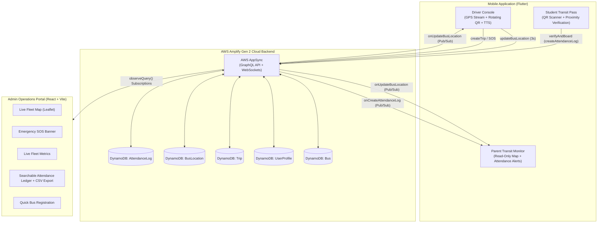

# VahanSync (SafarPass)

> **Next-Generation Campus Transit, Real-Time Fleet Telemetry & Anti-Proxy Attendance Ecosystem**

[](https://flutter.dev)
[](https://react.dev)
[](https://www.typescriptlang.org)
[](https://docs.amplify.aws)
[](https://aws.amazon.com/appsync/)
[](LICENSE)

---

## 📌 Executive Summary

**VahanSync (SafarPass)** is an enterprise-grade transit operations and safety management platform built for modern educational institutions, corporate campuses, and smart fleets. It bridges the gap between bus drivers, student passengers, parents, and administrative fleet dispatchers into a cohesive, zero-latency, real-time tracking and verification loop.

The system addresses the primary pain points of legacy campus transit systems:
1. **Proxy Attendance & Gate Fraud**: Eliminated via multi-tier cryptographic and geospatial verification.
2. **Transit Anxiety & Blind Spots**: Solved with real-time continuous GPS telemetry streaming (every 3 seconds) and instant parent notifications.
3. **Emergency Blind Spots**: Mitigated through one-touch driver SOS dispatching with live alerting on central administrative dashboards.
4. **Offline Resilience**: Offline fallback passes and hybrid connectivity layers keep boarding moving even during poor cellular coverage.

---

## 🏗️ System Architecture



---

## 🚀 What Has Been Developed (MVP State)

### 1. Cloud Backend (`admin_web/amplify/`)
- **Amplify Gen 2 Code-First Schema**:
  - `Bus`: Fleet registry (`busId`, `routeName`, `capacity`, `qrSecret`).
  - `UserProfile`: Role credentials with secondary index for fast logins (`userId`, `loginId`, `pin`, `fullName`, `role`, `assignedBusId`, `parentOfStudentId`, `feePaid`).
  - `Trip`: Active route journeys (`id`, `busId`, `driverId`, `status`, `startedAt`).
  - `BusLocation`: Live real-time telemetry (`busId`, `tripId`, `lat`, `lng`, `speed`, `heading`, `boardedCount`).
  - `AttendanceLog`: Audited scans (`id`, `tripId`, `busId`, `studentId`, `studentName`, `scanLat`, `scanLng`, `scannedAt`).
- **Authorization**: Configured with `a.authorization((allow) => [allow.publicApiKey()])` for rapid local prototyping and test suites.

### 2. Multi-Role Mobile App (`mobile_app/`)
Built with Flutter & Material 3 using a high-contrast deep slate (`#0F172A`) and vibrant emerald (`#10B981`) design system:
- **Unified Login Screen**:
  - Safe area, non-overflow scrollable layout.
  - 3-tab segmented role switcher (**Driver Mode**, **Student Mode**, **Parent Mode**).
  - Pre-filled demo credentials, obscure PIN toggle, and full-width primary action.
- **Driver Console (`DriverScreen`)**:
  - **Idle State**: 190x190 circular emerald `START TRIP` hero button with live GPS readiness check.
  - **Continuous Telemetry Stream**: Uses `Geolocator.getPositionStream` with `AndroidSettings(accuracy: bestForNavigation, intervalDuration: 3s)` and foreground service notification.
  - **Dynamic Anti-Proxy QR**: Generates rotating HMAC-SHA256 signatures refreshed every 15 seconds:
    $$\text{Payload} = \text{busId} \mid \text{tripId} \mid \text{timestamp} \mid \text{HMAC-SHA256}(\text{data}, \text{secret})$$
  - **Live Voice Announcements**: Integrated with `flutter_tts`—announces *"Boarded [Count]"* whenever a student scans.
  - **Simulation Toggle**: Allows desk testing by cycling through 8 calibrated campus waypoints.
  - **Safety Controls**: Persistent emergency SOS trigger and trip termination workflow.
- **Student Transit Pass (`StudentScreen`)**:
  - **Anti-Proxy Verification Engine**:
    1. *Cryptographic Verification*: Validates HMAC-SHA256 signature against bus secret.
    2. *Temporal Expiry (30s TTL)*: Rejects screenshots or shared photos.
    3. *Spatial Proximity Check*: Enforces that student GPS is within 50 meters of the bus.
    4. *Duplicate Prevention*: Idempotent tracking per trip key.
  - **Split-View Interface**:
    - Top: 260px map card with live bus marker, speed indicator, Street / Esri Satellite toggle, and **Google Maps ↗** walking direction launcher.
    - Bottom: Tabbed switcher between high-speed camera scanner and static fallback ID QR pass.
- **Parent Transit Monitor (`ParentScreen`)**:
  - **Real-Time Attendance Status**: Listens via AppSync WebSocket to `onCreateAttendanceLog`, automatically flipping from *"Waiting to Board"* to *"Boarded BUS_01 at [timestamp]"*.
  - **Live Bus Tracking**: Read-only OpenStreetMap / Esri Satellite layer with speed, heading, and **Google Maps ↗** navigation.

### 3. Admin Operations Portal (`admin_web/`)
- **Real-Time Operations Dashboard**: Subscribed directly to Amplify Gen 2 `observeQuery()` streams for `BusLocation`, `Trip`, `AttendanceLog`, and `Bus`.
- **Live Interactive Fleet Map**: Powered by `react-leaflet`, centering on campus coordinates with custom bus markers, live speed, boarded student counts, and external Google Maps links.
- **Emergency Flashing SOS Banner**: Alerts dispatchers immediately if any trip status transitions to `'sos'`, with one-click resolution.
- **Searchable Attendance Ledger**: Real-time table filterable by student name, roll number, or bus ID, with a one-click **"Export CSV"** button (`vahansync_attendance.csv`).
- **Quick Bus Registration**: In-portal modal to add new fleet buses directly into DynamoDB.

---

## 📂 Project Structure

```text
campus-transit-mvp/
├── admin_web/                           # Admin Web Operations Portal (React + Vite)
│   ├── amplify/                         # AWS Amplify Gen 2 Backend Configuration
│   │   ├── auth/                        # Authentication Resource Definitions
│   │   ├── data/                        # GraphQL Data Schema & DynamoDB Models
│   │   │   └── resource.ts              # 5 Core Models (Bus, UserProfile, Trip, etc.)
│   │   ├── backend.ts                   # Centralized Backend Resource Export
│   │   └── package.json
│   ├── src/
│   │   ├── App.tsx                      # Dashboard UI, Leaflet Map & Subscriptions
│   │   ├── App.css                      # Dark Slate / Emerald Operations Theme
│   │   ├── main.tsx                     # Amplify Configuration & React Mount
│   │   └── index.css
│   ├── package.json
│   ├── tsconfig.json
│   └── vite.config.ts
│
├── mobile_app/                          # Cross-Platform Mobile Client (Flutter)
│   ├── android/                         # Android Native Manifest & Permissions
│   │   └── app/src/main/AndroidManifest.xml
│   ├── lib/
│   │   ├── main.dart                    # App Entrypoint, Global M3 Theme & Permissions
│   │   ├── amplify_outputs.dart         # Local / Deployed Amplify Configuration
│   │   ├── screens/
│   │   │   ├── login_screen.dart        # Role-Based Selector & Authentication
│   │   │   ├── driver_screen.dart       # GPS Streaming, Rotating QR, TTS & SOS
│   │   │   ├── student_screen.dart      # Scanner, Anti-Proxy Verification, Fallback Pass
│   │   │   └── parent_screen.dart       # Live Tracking & Attendance Subscription
│   │   └── services/
│   │       ├── driver_telemetry_service.dart   # GPS Stream & Telemetry Mutator
│   │       └── student_boarding_service.dart   # 3-Tier Anti-Proxy Engine & AppSync Log
│   ├── test/
│   │   └── widget_test.dart             # Smoke & Role Switcher Tests
│   └── pubspec.yaml                     # Dependencies (geolocator, mobile_scanner, etc.)
└── README.md                            # Complete Project Documentation
```

---

## 🛠️ Getting Started & Local Development

### Prerequisites
- **Git** installed on your system.
- **Node.js** (v18.x or v20.x) & **npm**.
- **Flutter SDK** (v3.13+ / Dart 3.x) with Android Studio or Xcode for device emulation.
- **AWS Account** and AWS CLI configured (optional for cloud sandbox, local code compiles out of the box).

---

### Step 1: Clone the Repository
```bash
git clone https://github.com/rishikesh-2k6/SafarPass.git
cd SafarPass
```

---

### Step 2: Configure & Run Admin Web Portal

1. Navigate to the admin web directory:
   ```bash
   cd admin_web
   ```
2. Install dependencies:
   ```bash
   npm install
   ```
3. (Optional) Run an AWS Amplify Cloud Sandbox for live DynamoDB/AppSync:
   ```bash
   npx ampx sandbox
   ```
4. Start the Vite local development server:
   ```bash
   npm run dev
   ```
5. Open [http://localhost:5173](http://localhost:5173) in your browser to view the Operations Dashboard.

---

### Step 3: Configure & Run Mobile Application

1. Open a separate terminal and navigate to `mobile_app`:
   ```bash
   cd mobile_app
   ```
2. Fetch Flutter packages:
   ```bash
   flutter pub get
   ```
3. Run static analysis and automated unit/widget tests:
   ```bash
   dart analyze
   flutter test
   ```
4. Launch the application on an Android Emulator, iOS Simulator, or connected physical device:
   ```bash
   flutter run
   ```

---

## 🧪 Testing the Complete Transit Loop (Desk Testing Guide)

You can test the entire ecosystem right at your desk without driving:

1. **Start the Trip on Driver Mode**:
   - Open the app &rarr; Select **Driver Mode** &rarr; Tap **Login as Driver**.
   - Enable the **Simulate** switch (top-right) to step through campus waypoints.
   - Tap the large emerald **START TRIP** button.
   - The driver screen will display the rotating QR code and begin streaming telemetry.
2. **Track Fleet on Admin Console**:
   - Open the Web Dashboard at `http://localhost:5173`.
   - The map will center on Amrita Amaravati campus with the bus marker moving along the route.
3. **Verify Boarding on Student Mode**:
   - Launch another instance or switch to **Student Mode**.
   - Ensure **Bypass 50m GPS** is checked for desk testing.
   - Point the camera at the Driver's rotating QR code.
   - The boarding pass turns green with **BOARDING VERIFIED**, and the Driver console will speak *"Boarded 1"* aloud via TTS.
4. **Monitor from Parent Mode**:
   - In **Parent Mode**, the banner flips immediately to *"Boarded BUS_01 at [time]"*.
5. **Emergency SOS Drill**:
   - Tap **SOS ALERT** on the Driver screen.
   - The Admin Portal immediately triggers a flashing red emergency alert banner with one-click resolution.

---

## 🔮 What We Are Going to Do Next (Roadmap)

- [ ] **Geofencing & Smart Arrival Notifications**:
  - Automatically alert parents when the bus is within 500 meters or 5 minutes of their student's assigned stop.
- [ ] **Driver Route Deviation Detection**:
  - AI-assisted anomaly detection if a driver strays outside the designated campus transit corridor.
- [ ] **Multi-Route & Schedule Management**:
  - Support multi-bus fleets (BUS_01 through BUS_20) with scheduled morning and evening timetables.
- [ ] **Push Notifications via FCM / AWS Pinpoint**:
  - Background push alerts even when the mobile app is terminated.
- [ ] **Automated Fee Gate Integration**:
  - Instant locking of the boarding QR scanner if student semester transport fees remain unpaid.
- [ ] **Carbon & Fuel Optimization Analytics**:
  - Fleet fuel consumption metrics based on idling time and average operational speed.

---

## 🤝 Contributing
Contributions, issues, and feature requests are welcome! Feel free to check the issues tab or submit a pull request.

## 📄 License
This project is licensed under the MIT License - see the LICENSE file for details.
